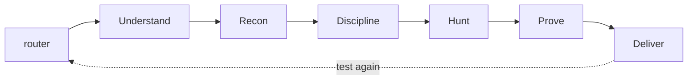

<p align="center">
  
</p>

<p align="center">
  <b>Method-first bug bounty skills for AI agents.</b><br>
  <i>A disciplined 6-stage hunting pipeline — the "prove it before you report it" layer most security skill packs are missing.</i>
</p>

<p align="center">
  <a href="LICENSE"></a>
  <a href="skills/"></a>
  <a href="docs/SKILL-FORMAT.md"></a>
  <a href="https://github.com/Aether-DZ/huntpack/stargazers"></a>
  <a href="https://github.com/Aether-DZ/huntpack/commits/main"></a>
</p>

[Agent Skills](https://agentskills.io) are small capability files an AI agent loads only when it
needs them. HuntPack gives your agent **12 bug-bounty skills** and a **router** that walks it
through a disciplined pipeline: understand the target → map the surface → hunt → stay honest →
**prove it** → write the report.

- **You don't spray payloads.** The router tells the agent which stage it's in and loads only the
  skills that fit.
- **Built to be trusted.** No theory — every finding must survive a proof gate before it's called
  a bug.
- **Runs on any agent.** Pure [Agent Skills](https://agentskills.io) — Claude Code, OpenCode,
  Codex, Cursor, Gemini CLI, Copilot, and [dozens more](https://agentskills.io/clients). Nothing to convert.

## Contents

- [What you can ask](#what-you-can-ask)
- [Why HuntPack is different](#why-huntpack-is-different)
- [How the router picks skills](#how-the-router-picks-skills)
- [The pipeline](#the-pipeline)
- [Catalog](#catalog)
- [Agent compatibility](#agent-compatibility)
- [Quick install](#quick-install)
- [Demo](#demo)
- [Repository layout](#repository-layout)
- [Safety & scope](#safety--scope)
- [Contributing](#contributing)

## What you can ask

Describe the target and the task in plain language. The router figures out the skills:

| You say | Skills it loads |
|---------|-----------------|
| "test the checkout for logic flaws on app.example.com" | `business-logic-hunter` + `api-security` |
| "map the attack surface of target.org" | `web2-recon` |
| "look for a race condition or IDOR" | `web2-vuln-classes` + `domain-scoped-hunting` |
| "is this IDOR report real? prove it" | `false-positive-killer` → `triage-validation` |
| "write up the finding" | `attack-path-builder` → `report-writing` |

You never name the skills on the right. That's the router's job.

## Why HuntPack is different

Most "hacking skill" repos are **payload dumps** — hundreds of curl one-liners with no way to tell
real from noise. HuntPack is the opposite:

| What others give you | What HuntPack gives you |
|---|---|
| A list of payloads | A full **pipeline**: understand → map → hunt → stay-honest → prove → deliver |
| "Could potentially be vulnerable" | **"PoC or nothing."** No proof → no claim → kill it. |
| A heap of files | 12 focused skills, each with evidence gates and exit rules |
| Breadth | The **business-logic + validation layer** that actually pays in bug bounties |

The core differentiator is the **discipline layer** — `domain-scoped-hunting`,
`false-positive-killer`, and `triage-validation`. They force the agent to *prove* a finding before
it ever reports it, which is exactly what separates a paid report from a `won't-fix`.

## How the router picks skills

You never name a skill. On each request the `router` does three things:

1. **Classifies the task** — understand / recon / hunt / discipline / prove / deliver.
2. **Detects the target** — web app? API? which archetype? (*application-archetypes*).
3. **Loads only the matching skills**, in pipeline order, and re-routes if the task pivots.



That's why "test checkout for logic flaws" loads `business-logic-hunter` + `api-security` and not
the 10 other skills.

## The pipeline

```
    ┌────────────┐   ┌───────────────┐   ┌───────────┐
  1 │  Understand │ → │ 2 Map surface │ → │ 3  Hunt   │
    └────────────┘   └───────────────┘   └─────┬─────┘
                                               │
    ┌────────────┐   ┌─────────────┐   ┌───────▼─────┐
 6  │  Deliver   │ ← │ 5  Prove     │ ← │ 4 Discipline │
    └────────────┘   └─────────────┘   └─────────────┘
```

| Stage | Skills | What it does |
|---|---|---|
| **0. Conduct** | `router` | Master dispatcher — tells the agent *where it is* and *what to run next*. |
| **1. Understand** | `application-archetypes` → `application-model-builder` | Recognize the target type, then build its model **before** any payload. |
| **2. Map surface** | `web2-recon` | Subdomains, live hosts, URL crawling, JS analysis, fuzzing. |
| **3. Hunt** | `web2-vuln-classes` · `business-logic-hunter` · `api-security` | 24 bug classes + business-logic execution + API patterns. |
| **4. Discipline** | `domain-scoped-hunting` | Domain declaration, boundaries, pivot hints, honest exit rules. **Anti-fabrication.** |
| **5. Prove** | `false-positive-killer` → `triage-validation` | Re-test from clean state; run the 8-question acceptance gate. |
| **6. Deliver** | `attack-path-builder` → `report-writing` | Chain findings into critical paths; write structured reports. |

## Catalog

12 skills across 6 categories — a full pipeline. Each links to its `SKILL.md`.

### Understand

`understand/` — figure out what you're attacking before you attack.

| Skill | Scope |
|-------|-------|
| [`application-archetypes`](skills/understand/application-archetypes/SKILL.md) | Instant target classification (e-commerce, SaaS, fintech, marketplace, admin…) + ready-made asset/role maps, top logic bugs per type |
| [`application-model-builder`](skills/understand/application-model-builder/SKILL.md) | Build the app model — assets, actors, permissions, workflows, trust boundaries — then break assumptions |

### Map surface — [`recon/`](skills/recon/)

| Skill | Scope |
|-------|-------|
| [`web2-recon`](skills/recon/web2-recon/SKILL.md) | Subdomain enumeration, live-host discovery, crawling, JS analysis, directory fuzzing, ASN/cloud recon |

### Hunt — [`hunting/`](skills/hunting/)

| Skill | Scope |
|-------|-------|
| [`web2-vuln-classes`](skills/hunting/web2-vuln-classes/SKILL.md) | 24 web2 bug classes — root causes, detection patterns, bypass tables, real paid examples |
| [`business-logic-hunter`](skills/hunting/business-logic-hunter/SKILL.md) | Business-logic execution matrix — SIGNAL → TEST → CONFIRM → KILL per pattern |
| [`api-security`](skills/hunting/api-security/SKILL.md) | REST / OAuth / JWT attack patterns |

### Discipline — [`discipline/`](skills/discipline/)

| Skill | Scope |
|-------|-------|
| [`domain-scoped-hunting`](skills/discipline/domain-scoped-hunting/SKILL.md) | **Anti-fabrication layer** — domain declaration, boundaries, pivot hints, honest exit proof. Load before any hunt. |

### Prove — [`validation/`](skills/validation/)

| Skill | Scope |
|-------|-------|
| [`false-positive-killer`](skills/validation/false-positive-killer/SKILL.md) | Re-test from a clean state, eliminate theoretical bugs, assign confidence |
| [`triage-validation`](skills/validation/triage-validation/SKILL.md) | 8-question acceptance gate before any report leaves |

### Deliver — [`reporting/`](skills/reporting/)

| Skill | Scope |
|-------|-------|
| [`attack-path-builder`](skills/reporting/attack-path-builder/SKILL.md) | Chain low/med findings into critical attack paths (ATO, privesc, data breach) |
| [`report-writing`](skills/reporting/report-writing/SKILL.md) | Structured reports — PoC, impact, remediation — across platforms |

## Agent compatibility

Every skill is a plain `SKILL.md` folder in the open [Agent Skills](https://agentskills.io)
standard — metadata plus a Markdown playbook the agent reads on demand. The same file loads
natively across Claude Code, OpenCode, Codex, Cursor, Gemini CLI, GitHub Copilot, Windsurf, Cline,
and [many more](https://agentskills.io/clients).

**Install with one command** using the universal CLI — it detects your agent and writes the skills
to the right place:

```bash
npx skills add Aether-DZ/huntpack
```

**Or copy by hand.** Drop a skill's `<name>/` folder into your agent's skills directory:

| Agent | Skills directory |
|-------|------------------|
| **Claude Code** | `~/.claude/skills/` |
| **OpenCode** | `~/.config/opencode/skills/` |
| **Codex · Gemini CLI · GitHub Copilot** | `~/.agents/skills/` |
| **Cursor** | `.cursor/skills/` |

## Quick install

### Option A — Claude Code plugin

```bash
claude install-plugin https://github.com/Aether-DZ/huntpack
```

### Option B — copy

```bash
git clone https://github.com/Aether-DZ/huntpack.git
cd HuntPack
mkdir -p ~/.claude/skills
cp -r router ~/.claude/skills/
cp -r skills/* ~/.claude/skills/
```

### Option C — Vercel skills CLI

```bash
npx @vercel/skills install --agent claude-code --scope personal --link ./skills
```

Restart your agent session. Full per-agent install, symlinks, and troubleshooting:
**[`docs/INSTALL.md`](docs/INSTALL.md)** · methodology walkthrough:
**[`docs/PIPELINE.md`](docs/PIPELINE.md)** · authoring standard:
**[`docs/SKILL-FORMAT.md`](docs/SKILL-FORMAT.md)**.

## Demo

One plain-English request goes in; the minimal right skills come out. Here's the shape of a real
exchange (illustrative):

```text
> test the checkout flow of app.example.com for logic flaws, with two accounts

Router → Understand. Detected archetype: e-commerce.
Loading application-archetypes → application-model-builder → business-logic-hunter + api-security.
Model built: guest / user_a / user_b / admin. Trust boundary: order.total is client-authoritative.
Hypothesis: coupon total manipulation on a race.
```

```bash
# prove it (abridged) — 20 parallel redeems, count successes, then verify ledger
seq 1 20 | xargs -P20 -I{} curl -s -o /dev/null -w "%{http_code}\n" \
  -X POST https://app.example.com/api2/coupon/redeem \
  -H "Cookie: <user_a>" -d '{"code":"TEST2026"}'
```

```text
21x 200 but 1 credit applied → not a race, killing path (false-positive-killer).
Server returned unique-constraint on the rest → serialized. Honest exit recorded.
```

## Repository layout

```
router/        master dispatcher — tells the agent where it is & what to run next
skills/        12 skills, organized by pipeline stage (understand · recon · hunting · discipline · validation · reporting)
docs/          PIPELINE · INSTALL · SKILL-FORMAT walkthroughs
scripts/       validate-skills.py — lint every SKILL.md (frontmatter, leaks, size)
.claude-plugin/ marketplace.json — one-command Claude Code install
.github/workflows/ validate.yml — CI that blocks bad PRs
```

Every `SKILL.md` uses only the open Agent Skills frontmatter (`name`, `description`) so it runs on
any standard-compliant agent with zero porting. Deep reference material lives in each skill's
`references/` folder (progressive disclosure).

## Safety & license

HuntPack is for **authorized** testing — your own applications, contractual pentests, or a target's
official bounty scope. Every skill assumes you **read the scope first**, send harmless
non-destructive requests, and never claim a finding without a reproducible proof-of-concept.

**MIT License** — see [LICENSE](LICENSE). Use it, modify it, share it.

> **Disclaimer:** These skills are methodology and educational material. You are responsible for
> complying with applicable laws and authorization for any target you test.

## Contributing

Read [`CONTRIBUTING.md`](CONTRIBUTING.md) and the authoring standard in
[`docs/SKILL-FORMAT.md`](docs/SKILL-FORMAT.md). Every skill must pass the validator before merge:

```bash
python3 scripts/validate-skills.py
```